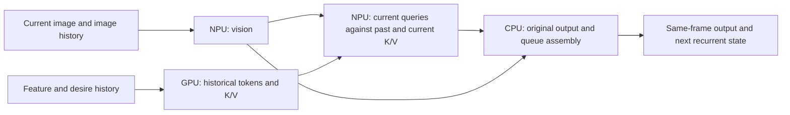

# Android: experimental same-frame Snapdragon causal prefill

This opt-in profile runs Cinque Terre V3 on the SM8750's Hexagon NPU and
Adreno GPU in parallel. It does not replace Automatic, NPU, or the existing
sequential NPU + GPU setting. It is limited to one validated model export and
one matched runtime stack; unsupported inputs fail with an error.

The Xiaomi 15 prototype completed a ten-minute, 20 Hz synthetic benchmark:
**27.2 ms mean, 29.5 ms P99, 36.2 ms max, 12,001 frames, zero over 50 ms**.
The original CPU accuracy gates passed on 128 identical synthetic frames before
and after the sustained run. [Screenshot, accuracy logs and machine-readable
results](evidence/sm8750-causal-prefill/README.md) distinguish the measured
prototype from the upstream port. Physical comma USB, car charging and road
behavior have not been validated by these results.

## Why this can overlap without adding a frame of delay

The model's eight attention masks are causal. Historical queries cannot read
the current image tokens, so the GPU can compute the 256 historical tokens
while the NPU computes the current image's vision features. The NPU then runs
the 32 current queries against **all 288 original keys and values**. Nothing is
reused from an earlier image to substitute for current-frame work.



`SessionDAG` derives completion barriers from graph I/O, rejects cycles and
multiple writers, and joins every worker before returning an error. The engine
double-buffers recurrent state and binds HTP sessions to host-accessible RPC
allocations. GPU and CPU sessions use ordinary CPU tensor metadata over those
pointers. They do not claim to be QNN shared allocators.

The existing fp16 normalization expression is prescaled by 1/4, with epsilon
divided by 16, to keep intermediates in range without expanding each native
LayerNormalization into many slower operations. This preserves the real-valued
formula, not bitwise floating-point results. Original CPU output gates remain
the acceptance criterion. The HTP graph adapter disables advanced activation
fusion; it forwards the other backend functions and retains custom graph
configuration until context destruction.

## Reproduce the exact model bundle

Tested tools: Swift 6.4, Python 3.12, ONNX 1.23.2, NumPy 2.5.4, ORT 1.29.0,
NDK r30, Android API 31 native target, QAIRT 2.47.0.260601 and HTP v79.
Use the original catalog export with SHA-256:

```
404a18cfd86d29637d20c697dfde245bb47c666ae016730ab674c65f4d1e1aa4
```

From a Linux checkout with the [Android build prerequisites](../android/README.md):

```bash
python3 -m venv .venv-prefill
.venv-prefill/bin/python -m pip install -r scripts/android/requirements-causal-prefill.txt
swift build --package-path JetlinkKit --product jetlink-prefill-base
BASE_TOOL="$(swift build --package-path JetlinkKit --show-bin-path)/jetlink-prefill-base"
.venv-prefill/bin/python scripts/android/compile_causal_prefill.py \
  --model /path/to/404a18cfd86d2963.onnx \
  --base-tool "$BASE_TOOL" --out /path/to/causal-prefill-v1
```

The output directory must be empty. The compiler checks the original model
hash, the intermediate graph hash, all four final graph hashes, and the exact
manifest bytes against the phone-tested bundle. The app independently verifies
the source model, manifest and each part before copying into its private cache.
This is deliberately a model-specific compiler, not a general ONNX optimizer.
No weights, output slices, correlation thresholds or feedback contract are changed.

## Build the opt-in Android app

Obtain QAIRT 2.47.0.260601 through Qualcomm's normal SDK distribution. Vendor
headers, libraries and model weights are not redistributed in this repository.
Use the complete matching HTP, GPU, prepare, system, IR, saver and v79 stub/skel
set: mixing an older Maven runtime with newer DSP libraries does not work.

```bash
export QNN_SDK_ROOT=/path/to/qairt/2.47.0.260601
export ANDROID_NDK_HOME=/path/to/android-ndk-r30
bash android/qnn/build.sh /path/to/qairt-jni
cd android
./gradlew :app:assembleRelease :app:testDebugUnitTest \
  -Pjetlink.causalPrefill=true -Pjetlink.qairtJniDir=/path/to/qairt-jni
```

The helper builds and tests the small graph adapter, then locates the eight
vendor libraries by their pinned byte hashes. Gradle verifies those same
hashes, requires the adapter and replaces the Maven QNN runtime only for this
opt-in build. Ordinary builds require no new SDK or property.

Install with the project's existing signing/install workflow. An APK signed
with a different key cannot update the official APK in place; preserve app
data and the previous APK before changing a locally signed installation.

Stage only the four ONNX files and manifest generated above into the app's
external files directory. For a USB-debugging development device:

```bash
BUNDLE=/sdcard/Android/data/io.zoompilot.jetlink.android/files/causal-prefill-v1
adb shell mkdir -p "$BUNDLE"
adb push /path/to/causal-prefill-v1/. "$BUNDLE/"
adb shell chmod 755 "$BUNDLE"
adb shell chmod 644 "$BUNDLE/vision.onnx" "$BUNDLE/history.onnx" \
  "$BUNDLE/decode.onnx" "$BUNDLE/join.onnx" "$BUNDLE/manifest.json"
```

The directory must be traversable by the app; an ADB-created shell-only 770
directory prevents loading. Select **NPU + GPU (experimental)** on an SM8750.
The existing NPU + GPU choice remains the original sequential profile. Keep
the original Cinque Terre V3 model downloaded/imported in Jetlink as usual.
Enable Keep NPU awake, Keep CPU awake and Keep screen on to reproduce the
measured configuration. Initial HTP compilation can take several minutes. Missing or different bundles
produce an error; there is no silent substitution of another model or CPU work.

## Validation and limits

The measured prototype used shared I/O, burst mode, CPU performance hints and
the screen awake. Airplane mode with Wi-Fi and Bluetooth off stabilized the
test conditions. It was not counted as an inference optimization.

| Run | Duration | Mean | P99 |
| --- | --- | --- | --- |
| Range-safe NPU-only control | 1 minute | 33.8 ms | 34.7 ms |
| Same four graphs, shared buffers, serial control | 1 minute | 45.2 ms | 47.2 ms |
| Causal parallel, ordinary heap buffers | 1 minute | 27.6 ms | 30.5 ms |
| Causal parallel, shared buffers | 1 minute | 26.8 ms | 29.0 ms |
| Normal USB-capable prototype, causal parallel/shared | 10 minutes | 27.2 ms | 29.5 ms |

These were sequential runs on one phone, without randomized order or fixed
temperature/clocks. Provider API spans overlap by about 22.1 ms in the sustained
run; this and the identical-graphs serial control demonstrate useful concurrent
execution. They do **not** establish an NPU/GPU busy percentage. Available QNN
profiling events did not provide comparable hardware timestamps, so there is no
claim of 100% accelerator utilization. See [ORT's QNN provider documentation](https://onnxruntime.ai/docs/execution-providers/QNN-ExecutionProvider.html)
for shared memory and fallback configuration.

The phone's battery temperature rose from 36.6°C to 45.4°C and battery charge
fell from 62% to 55% despite PC USB power. Every recorded Android thermal status
and all 61 benchmark windows remained Normal. That status does not mean the
phone was cool or that a car adapter can sustain charging. Test the actual
mount, cable, power adapter and comma connection while parked before any use.

The prototype's two 128-frame checks use the unchanged original CPU model,
identical inputs and independent recurrent state on both sides. The checked-in
logs include per-slice/per-column results and the original 0.999-correlation or
existing quiet-output error fallback. Synthetic correctness is not a driving
validation or a guarantee for every input, temperature or firmware update.

For another phone accuracy capture, use the existing `scripts/verify_parity.py`
without changing its comparison thresholds. With the original model already
cached, the new profile loaded, and Developer mode enabled, a parked development
device can be checked over an ADB TCP forward:

```bash
adb forward tcp:15599 tcp:5599
python scripts/verify_parity.py capture --host 127.0.0.1 --port 15599 \
  --sha256 404a18cfd86d29637d20c697dfde245bb47c666ae016730ab674c65f4d1e1aa4 \
  --nbytes 766354845 --n 128 --dir parity-prefill
python scripts/verify_parity.py reference --onnx /path/to/404a18cfd86d2963.onnx --dir parity-prefill
python scripts/verify_parity.py compare --dir parity-prefill
adb forward --remove tcp:15599
```

For a developer serial control, set `parallel_serial: true` in the native start
configuration, keeping the same graphs and shared buffers. Its artifact tag is
separate. With Developer mode enabled, `parallel-stages.json` records synchronous
provider-call timing spans in the external files directory. Disable Developer
mode after collecting a test; the comma does not need the TCP listener.

To stop using the experiment, choose an existing processor setting. Automatic
and existing profiles retain their original options and caches. Reinstalling a
previous APK signed with the same key is a separate local rollback option.
