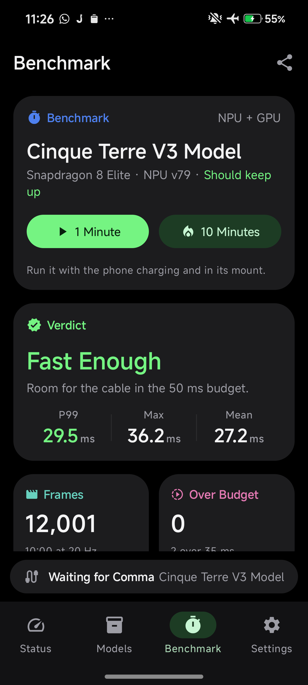

# SM8750 causal-prefill evidence

These are unmodified benchmark pixels and sanitized numeric/log results from the
Xiaomi 15 prototype, not a screenshot of the upstream port. No device serial,
network address, signing key, model weights or Qualcomm SDK binaries are included.

`results.json` records the conditions, controls and limitations. Both accuracy
logs compare 128 identical synthetic input frames against the unchanged original
CPU model, each side maintaining its own recurrent state; thresholds are unchanged.
`windows.json` contains all 61 reported ten-second windows, including the final
one-frame window. This is a model/host benchmark, not physical comma USB validation.
